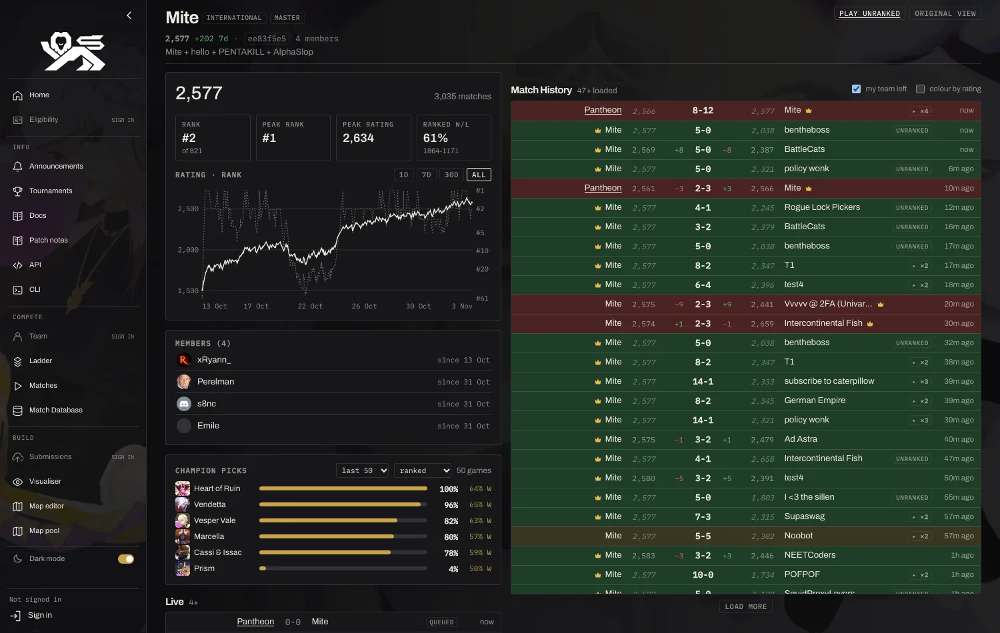
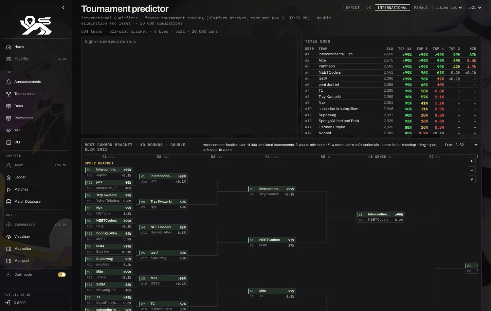

# secret pantheon tech

**Compact team, matches and ladder pages for Cambridge Battlecode, plus stats and a tournament predictor.**

Florent-style dense layouts on [2026a.battlecode.co.uk](https://2026a.battlecode.co.uk/game/ladder), keeping cambc's
own theme (light and dark), with the numbers you actually want while scrimming: win rate by map, how you do against
each champion, what other teams draft, head-to-head on the ladder, and who's likely to win the next tournament.

[**Install**](#install) · [Screenshots](#screenshots) · [Features](#features) · [Troubleshooting](#troubleshooting) · [Releases](https://github.com/yufanwang07/secret-pantheon-tech/releases)

---

## Install

### 1. Install a userscript manager

| Browser | Extension |
|---|---|
| Chrome, Brave, Arc, Opera | [Tampermonkey](https://chromewebstore.google.com/detail/tampermonkey/dhdgffkkebhmkfjojejmpbldmpobfkfo) or [Violentmonkey](https://chromewebstore.google.com/detail/violentmonkey/jinjaccalgkegednnccohejagnlnfdag) |
| Edge | [Tampermonkey](https://microsoftedge.microsoft.com/addons/detail/tampermonkey/iikmkjmpaadaobahmlepeloendndfphd) |
| Firefox | [Tampermonkey](https://addons.mozilla.org/firefox/addon/tampermonkey/) or [Violentmonkey](https://addons.mozilla.org/firefox/addon/violentmonkey/) |

> [!IMPORTANT]
> **Chrome and other Chromium browsers:** open `chrome://extensions`, click **Details** on your userscript manager and
> turn on **Allow User Scripts** (on Chrome before 138, turn on **Developer mode** instead). Without it the script
> installs but never runs. See [Tampermonkey's FAQ](https://www.tampermonkey.net/faq.php#Q209).

### 2. Install the script

**[➜ Click here to install secret pantheon tech](https://raw.githubusercontent.com/yufanwang07/secret-pantheon-tech/main/secret_pantheon_tech.user.js)**

Your userscript manager opens an install page: click **Install**, then open or refresh any page under
`2026a.battlecode.co.uk/game/`. Sign in to the platform for everything tied to your team (your stats, head-to-head,
"my team" highlighting).

A pinned copy of each version is attached to every [release](https://github.com/yufanwang07/secret-pantheon-tech/releases).

### Updating

Installs from the link above update themselves (Tampermonkey checks about once a day). To update now, click
**Check for userscript updates** in the Tampermonkey dashboard, or open the install link again.

---

## Screenshots

<table>
<tr>
<td width="50%"> <b>Team page.</b> Rating and rank over time (1d / 7d / 30d / all), members, champion pick rates over the last 5 / 50 / 500 games with win rate per pick, and a dense match history with ratings and deltas.</td>
<td width="50%"> <b>Tournament predictor.</b> Title odds for the next tournament from the ladder (or its frozen seeding once it's out), single or double elimination, and the most common bracket on a zoomable canvas.</td>
</tr>
</table>

---

## Features

**Team page**
- Compact header with rating, 7-day change, tier and members; one-click **play unranked** against the team.
- Rating and rank chart with 1d / 7d / 30d / all ranges.
- **Champion picks**: how often the team drafted each champion over its last 5 / 50 / 500 games (ranked or all), with the win rate when picked.
- **Win rate by map**: against this team (your recent games on your active bot), or on your own page normalized across opponents.
- **Matchups**: the team's map win rate against each opponent, sortable by ladder rank or win rate.
- Matches of interest (games against your team), live/queued matches and the full match history, your team on the left, rows coloured by result or by rating.

**Matches page**
- The same compact history, with your team's live matches pinned on top and runs of rematches folded together.
- **Statistics of interest**: normalized win rate (every opponent weighted equally), by map, vs each enemy champion, with each of your picks, toughest opponents, game length and how games end. Scoped to your active bot, newest upload or a time window (last hour to 7 days), ranked/unranked.
- "Active bot unranked only" filter.

**Ladder**
- Denser rows, team names in their tier's colour, and a **vs** column with your recent head-to-head against each team.
- **Qualified** filter next to All / Students / Intl / UK: only the teams qualified for the finals (top 8 of each finished qualifier, read from its bracket and cached), in rating order, numbered among themselves with the overall rank small beside it. In the normal views their eligibility icon turns gold and their row gets a gold edge; *qualifier highlights* (top right) turns that off.
- Category views show the overall rank as a small grey number instead of in parentheses; GM and Master team names are a deeper red and a brighter pink.

**Tournament predictor** (a new *Predictor* entry in the sidebar)
- Fields for sprints, UK, International and finals; sprints are single elimination, qualifiers and finals double elimination (no reset).
- Per-game odds from Elo, nudged by your real head-to-head games (pick which of your bot versions counts); series of bo5 to bo21 solved exactly (single elim) or simulated 20,000 times (double elim).
- Uses the platform's frozen seeding and bracket once a tournament's seeds are captured.
- Your own run (title odds, likely exit, who knocks you out), the full title-odds table, and the **most common bracket**: both brackets and the grand final on one canvas (drag to pan, ctrl+scroll or the buttons to zoom), with each team's series win chance in every matchup.

**Everywhere**
- Follows cambc's light/dark theme; "original view" switches any page back to the platform's own.
- Links each game of a match group to an alternative replay viewer.

---

## Troubleshooting

<b>Pages look unchanged</b>

Make sure **Allow User Scripts** (or Developer mode) is on for your userscript manager, the script is enabled, and
refresh the page. Check that you didn't switch the page to **original view**.

<b>No stats for my team / everything says "sign in"</b>

Sign in on the platform: your team, head-to-head and stats come from your account's own match data. The first load
of your stats fetches every recent match group, so it can take a minute; after that it's cached.

<b>The predictor looks off</b>

Odds are only as good as the ladder ratings plus your recent head-to-head. Before a tournament's seeding is frozen
the field is the current ladder (dev teams excluded), so it moves with every rating change.

Found a bug? [Open an issue](https://github.com/yufanwang07/secret-pantheon-tech/issues).

---

Free and non-commercial. Not affiliated with Cambridge Battlecode or Florent Code League. Licensed under the [MIT License](LICENSE).
